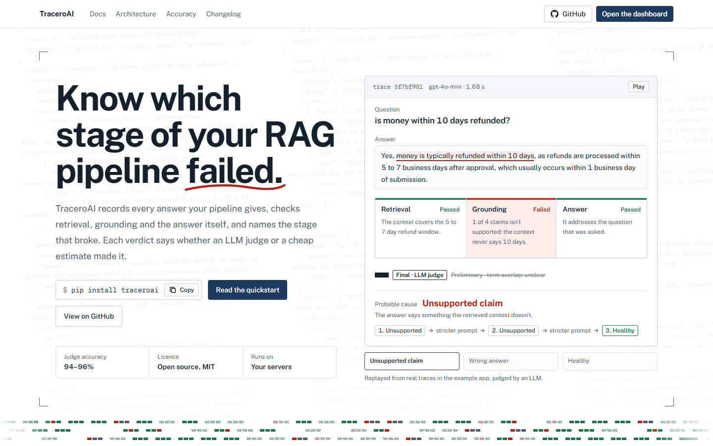
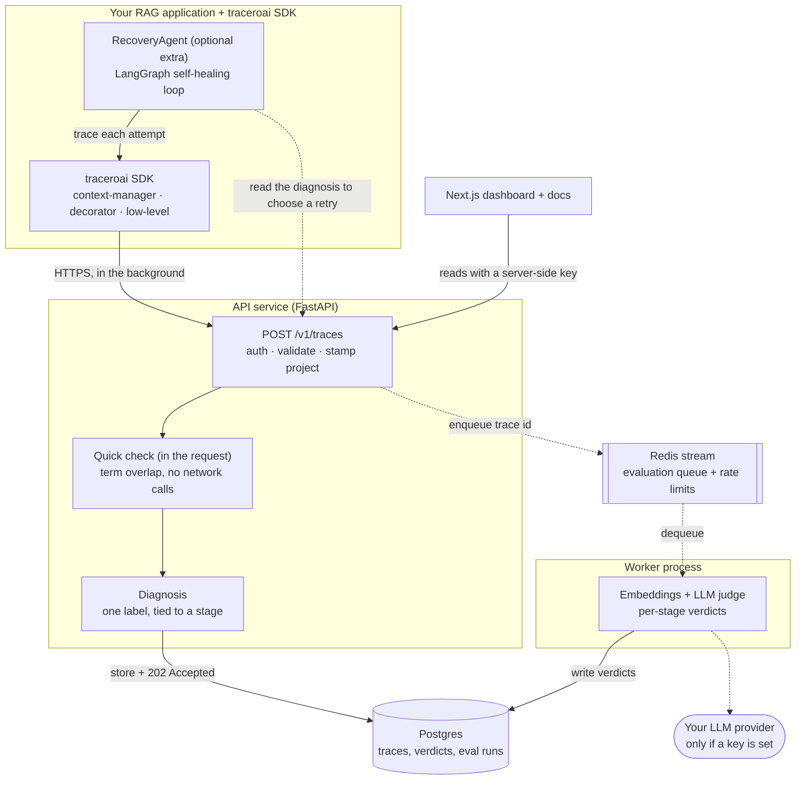
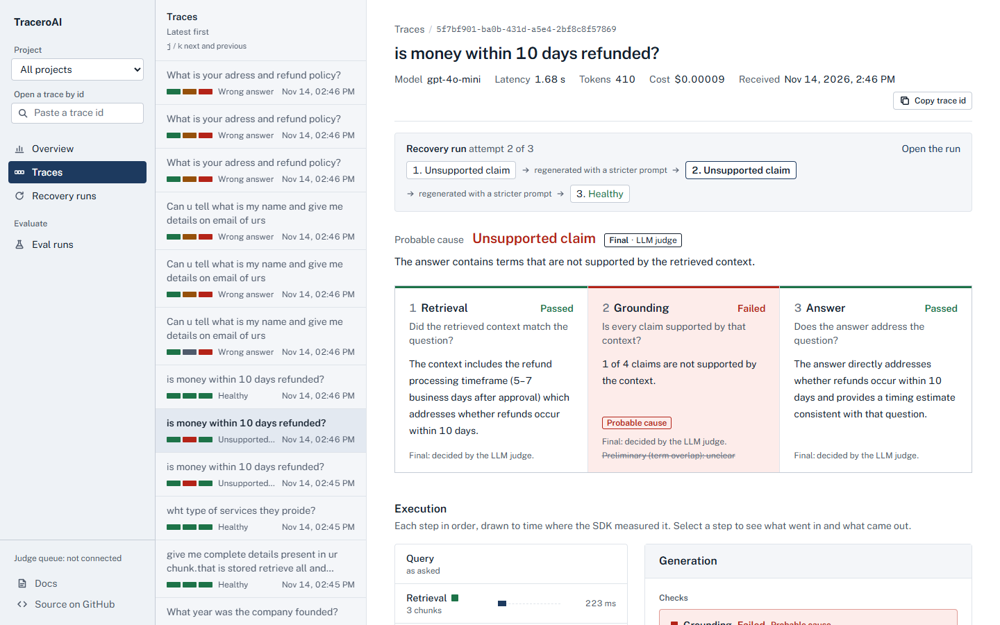
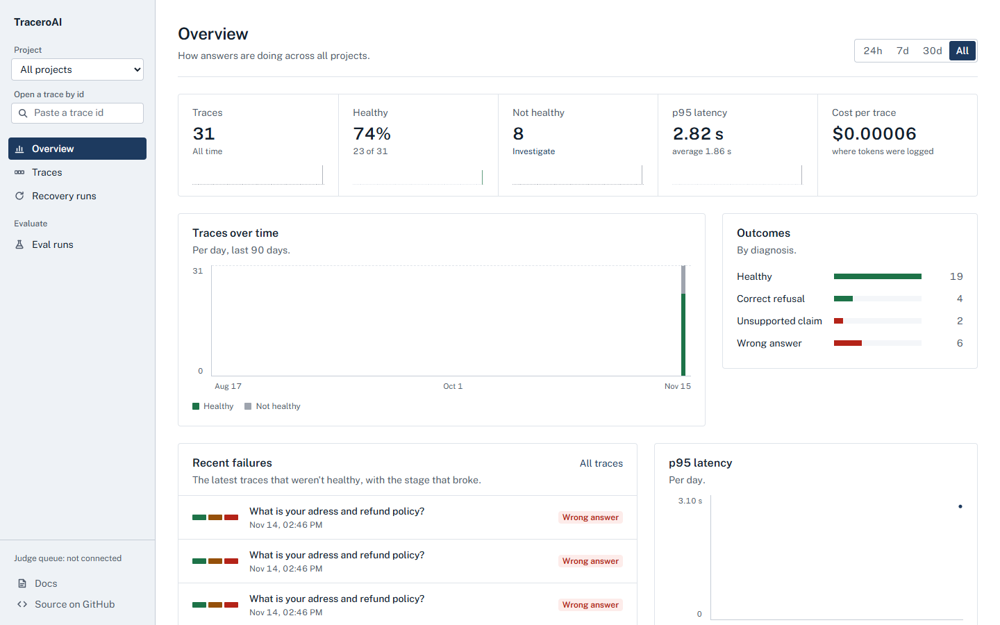
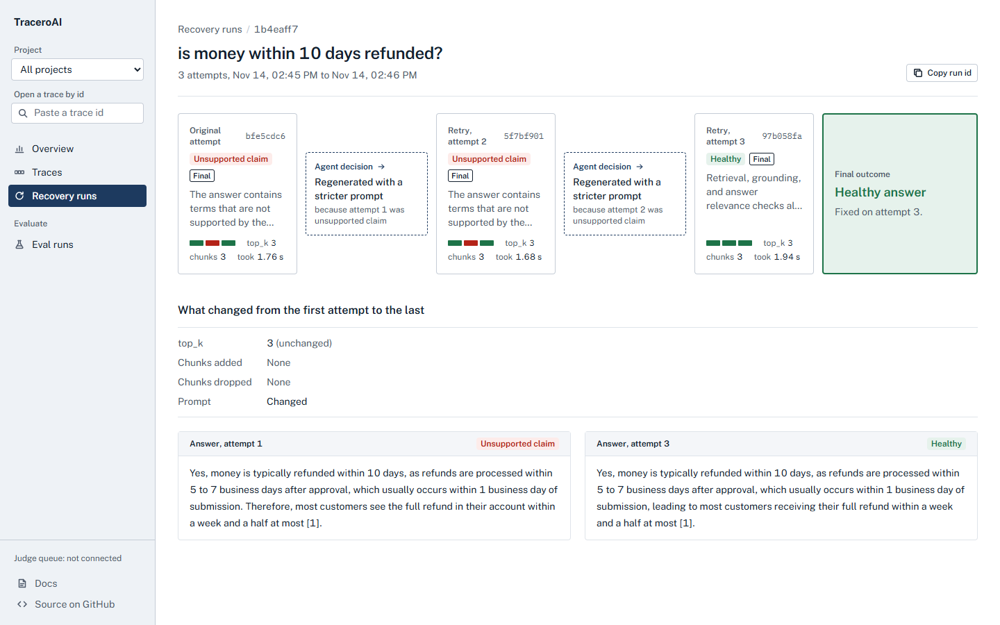
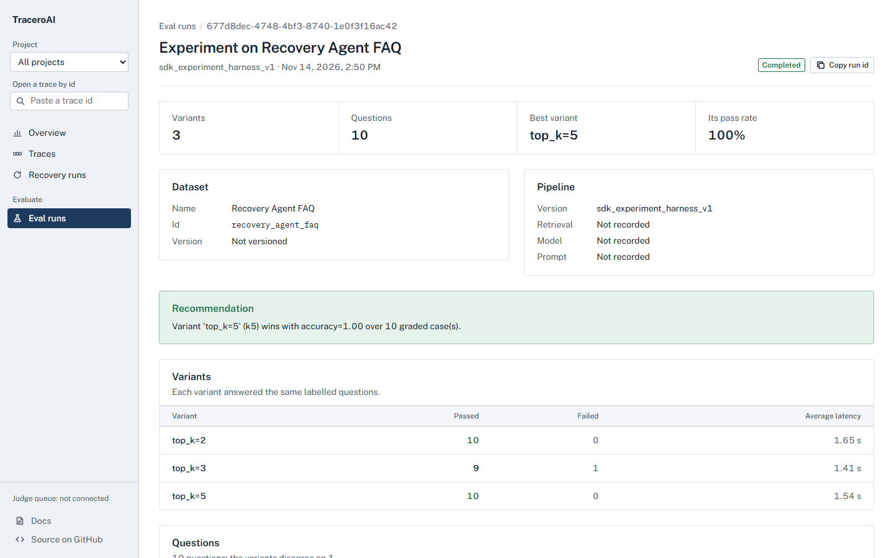

<div align="center">

# TraceroAI

**RAG observability, evaluation, and debugging — built like production infrastructure.**

When a RAG answer is wrong, TraceroAI shows *why*: whether the failure came from
retrieval, the context, grounding, or the generated answer.

[](https://pypi.org/project/traceroai/)
[](https://www.python.org/)
[](./LICENSE)

**[Website →](https://www.traceroai.tech)** &nbsp;·&nbsp;
**[Interactive docs →](https://www.traceroai.tech/docs)** &nbsp;·&nbsp;
**[PyPI →](https://pypi.org/project/traceroai/)**&nbsp;·&nbsp;
**[DEV.to →](https://dev.to/chinmai_sd/building-traceroai-a-better-way-to-debug-rag-applications-bhn)**

</div>



---

## The problem

A bad RAG answer is only a *symptom*. The real cause could be anywhere in the pipeline:

```
user query → retrieval → context selection → prompt → generation → answer
```

Teams ship RAG systems with almost no visibility into *which stage* failed. Was the
right document never retrieved? Was it retrieved but ignored? Did the model
hallucinate beyond its context? "The answer is wrong" doesn't tell you where to look.

**TraceroAI traces every RAG answer and diagnoses the failure stage**, so debugging
becomes a lookup instead of a guess.

## Demo

A 30-second walkthrough: trace an answer, judge it, and let the recovery agent heal the failure.

https://github.com/user-attachments/assets/9e94fdb2-fc38-4ef6-9288-69bd23c2ef73

## What it does

- **Trace every answer**: the question, the retrieved chunks, the prompt, the answer, and
  how long each step took.
- **Evaluation in tiers**: a quick term-overlap check runs the moment a trace arrives,
  with no network calls. With a provider key, embeddings and an **LLM judge** run in the
  background and the judge's verdict replaces the estimate. Every diagnosis says which
  tier made it, and each tier's accuracy is
  [measured and published](docs/evaluation-benchmark.md).
- **One diagnosis per answer**, tied to the pipeline stage that failed:

  | Diagnosis | Stage | Meaning |
  |---|---|---|
  | `healthy_answer` | | retrieval, grounding and the answer all passed |
  | `correct_refusal` | | the context didn't cover the question, and the model said so |
  | `retrieval_miss` | Retrieval | the retrieved context doesn't match the question |
  | `low_context_relevance` | Retrieval | the context is only loosely related |
  | `unsupported_claim` | Grounding | the answer states something the context doesn't support |
  | `wrong_answer` | Answer | grounded, but it doesn't answer the question, or refuses one it could |
  | `needs_review` | | the checks couldn't decide; a person should look |

- **Drop-in SDK** — `pip install traceroai`; instrument any RAG pipeline in a few lines.
- **Self-healing recovery** (`pip install traceroai[recovery]`): a LangGraph agent that
  retries the stage that broke. A retrieval miss retrieves more context; an unsupported
  claim regenerates with a stricter prompt; it stops after a bounded number of attempts.
  Every attempt is traced and shown as one run in the dashboard.
- **Experiments** (`traceroai.eval`): run a labelled dataset through each version of your
  pipeline, grade every answer with the judge, and see which questions the variants
  disagree on. Bring your own retrieve and generate.
- **Cost & token tracking** — per-trace prompt/completion tokens and computed cost.
- **Project isolation** — a project API key writes to and reads only its own project;
  admin keys (used by the dashboard's server) see every project. See
  [Auth and access](#auth-and-access).

See **[USAGE.md](USAGE.md)** for a complete guide to every SDK feature.
## Articles

### Why I Built TraceroAI

I wrote a short article about the motivation behind TraceroAI, the challenges of debugging RAG systems, and what I learned while building an AI evaluation and observability platform.

**Read on DEV Community:** [Why I Built TraceroAI: Debugging RAG Applications Beyond Hallucinations](https://dev.to/chinmai_sd/building-traceroai-a-better-way-to-debug-rag-applications-bhn)

## Architecture

TraceroAI separates the **write path** (fast, synchronous, must never block the caller)
from the **evaluation path** (slow, costly, rate-limited). Ingest returns in
milliseconds; expensive LLM judgement happens asynchronously and is reconciled back
onto the trace.



> Solid arrows are the synchronous request path; dotted arrows are the asynchronous
> evaluation path. The **RecoveryAgent** runs client-side: it traces each attempt and
> reads back the diagnosis to decide whether (and how) to retry.

### Request lifecycle

1. The SDK sends a trace (query, retrieved chunks, prompt, answer) to `POST /v1/traces`.
2. The API checks the project key, runs the **quick check** (term overlap, no network
   calls), computes a preliminary **diagnosis**, stores the trace, and returns
   **`202 Accepted`**. The caller never waits on evaluation.
3. The trace id goes onto a **Redis stream**.
4. A **worker** runs embeddings and the **LLM judge** and writes their verdicts back; the
   judge's diagnosis replaces the estimate and is marked Final.
5. The **dashboard** reads traces, metrics, recovery runs and experiments from the API.

Beyond this core flow, two SDK features build on it: the **experiment harness**
(`traceroai.eval.run_experiment`) replays a labeled dataset across pipeline configs,
grades via the server-side judge (`POST /v1/eval/grade`), and recommends a winner; and
the **RecoveryAgent** uses the per-attempt diagnosis to drive a self-healing retry loop.
Both inject your own retrieve/generate — the platform owns evaluation + storage, not the
pipeline.

### Design decisions & trade-offs

| Decision | Why | Trade-off accepted |
|---|---|---|
| **Evaluation in tiers** (term overlap on ingest → embeddings and LLM judge in the background) | Ingest never calls a provider, so it stays fast and works offline; the judge does the claim-level reasoning the cheap checks can't | Until the judge runs, the diagnosis is an estimate (58% accurate on the benchmark against the judge's 94–96%), and the dashboard marks it Preliminary |
| **Hosted embeddings, not local** | Embedding relevance runs via a hosted API (reusing the judge config), so the lean API process never has to load PyTorch / a model into memory | A network call + tiny per-trace cost vs. a local model |
| **Async deep eval via Redis queue** | LLM calls are slow and rate-limited; keeping them off the ingest path keeps `POST /v1/traces` fast and resilient | Eventual consistency — a trace is diagnosed twice (quick, then deep) |
| **`LLMJudge` / embeddings behind config** | Provider is a one-line swap (OpenAI ↔ Gemini's OpenAI-compatible endpoint); makes eval unit-testable with stubs | A thin abstraction layer over the provider SDK |
| **Self-healing recovery as an opt-in extra** (`traceroai[recovery]`) | A LangGraph loop turns the eval pipeline into a feedback signal that *fixes* answers, not just observes them; shipped as an extra so the base SDK stays lean | Pulls langgraph only for users who want it; bounded by max-attempts to prevent infinite loops |
| **Eval-runs harness grades correctness with an LLM** | A/B-comparing pipeline configs needs a correctness signal; grading failures are tracked as *ungradeable*, not silently counted as wrong | Cost of one LLM call per case; mitigated by small datasets |
| **Cost priced from a live source** | The SDK sends token counts; the server prices them from the community-maintained LiteLLM map (~thousands of models, cached) with a small built-in table as fallback — so prices stay current without hand-maintenance | One cached fetch on startup; unknown models return no cost (never guessed) |
| **Traces stored as JSONB** | The trace schema evolves fast; JSONB avoids migrations per field while still being queryable | Less rigid than fully normalized columns |
| **Fail-open everywhere** | No key, a 429 from the provider, or an unreachable Redis must never break ingest or the public demo | A degraded path silently falls back to the cheaper result |
| **Per-IP rate limit on the public demo** | The `/playground` endpoint is unauthenticated and burns shared LLM quota; a fixed-window Redis counter caps abuse | Fixed-window is coarser than a sliding window (acceptable for a demo) |

See [`docs/traceroai-system-plan.md`](docs/traceroai-system-plan.md) for the full design.

## Screenshots

Screens from the example app in [`examples/recovery-agent/`](examples/recovery-agent/),
judged by the LLM judge.

| A trace | Overview |
|---|---|
| [](docs/media/trace-detail.png) | [](docs/media/dashboard.png) |
| The verdict, the findings for each stage, and the execution step by step. This answer's grounding failed; the recovery agent fixed it on attempt 3. | Traces over time, the healthy share, p95 latency, outcomes by diagnosis, and recent failures. |
| **A recovery run** | **An experiment** |
| [](docs/media/recovery-run.png) | [](docs/media/experiment.png) |
| Each attempt, the agent's decision between attempts, and what changed. | Three top_k values on the same ten questions, with the one they disagree on first. |

## Quickstart

Install the SDK:

```bash
pip install traceroai
```

Start the stack ([Running locally](#running-locally)), then instrument your pipeline. The
context manager times each step and sends the trace in the background when the block
exits:

```python
from traceroai import TraceroClient

client = TraceroClient(base_url="http://localhost:8000")   # or set TRACEROAI_API_URL

with client.trace("How long does a refund take?") as t:
    chunks = retrieve(question, top_k=3)  # your retriever
    t.log_retrieval(chunks, strategy="hybrid")
    answer = generate(question, chunks)   # your LLM
    t.log_generation(answer, model="gpt-4o-mini")
```

Then open the dashboard at <http://localhost:3000> to inspect the trace. The
[documentation](https://www.traceroai.tech/docs) covers every option.

A complete, runnable example is in [`examples/recovery-agent/`](examples/recovery-agent/) —
it showcases tracing, self-healing recovery, and an eval run (`python app.py --eval`).

## Tech stack

| Layer | Stack |
|---|---|
| **API** | FastAPI · Pydantic · SQLAlchemy |
| **Storage** | Postgres (JSONB) · Redis (async deep-eval queue + rate limiter) |
| **Evaluation** | Term overlap on ingest · embedding relevance and an LLM judge in the background (any OpenAI-compatible provider) · experiment harness |
| **SDK** | Python (`httpx`), context-manager + decorator + low-level APIs; optional `[recovery]` extra (LangGraph) |
| **Web** | Next.js · Tailwind CSS |
| **Deploy** | Render (API + colocated worker) · Vercel (web) · Neon (Postgres) · Upstash (Redis) |

## Repository structure

```
TraceroAI/
├── services/api/          FastAPI backend — ingest, evaluators, LLM judge, worker
│   └── app/
│       ├── api/routes/     traces · metrics · recovery runs · eval runs · grading · jobs · health
│       ├── evaluators/     quick checks + embedding relevance + LLM judge + diagnosis
│       └── services/       repositories · queue · rate limiter · judge · embeddings · cost
├── sdks/python/           the `traceroai` package (PyPI) — client, tracing,
│                          recovery agent (traceroai.recovery), eval harness (traceroai.eval)
├── traceroai-web/         Next.js dashboard + interactive docs
├── examples/recovery-agent/   full showcase — tracing, query rewrite, cost, self-healing recovery, eval run
├── infra/                 Docker Compose for the whole stack
├── docs/                  system design plan + screenshots
└── USAGE.md               complete SDK usage guide
```

## Running locally

### Everything in Docker

```bash
docker compose -f infra/docker-compose.yml up --build
```

This starts Postgres, Redis, the API on <http://localhost:8000> (interactive API docs at
`/docs`), the deep-evaluation worker, and the dashboard on <http://localhost:3000>. The
schema is created on first start. Point the SDK at it:

```python
client = TraceroClient(base_url="http://localhost:8000")
```

Traces are scored by the deterministic checks out of the box. To add the LLM judge, export
`TRACEROAI_OPENAI_API_KEY` (and optionally `TRACEROAI_JUDGE_MODEL`,
`TRACEROAI_JUDGE_BASE_URL`, `TRACEROAI_EMBEDDING_MODEL`) before `up`.

The stack runs with `TRACEROAI_APP_ENV=development`, where API keys are optional. Set it to
`production` and configure `TRACEROAI_PROJECT_API_KEYS` before exposing it to a network.

### API and web outside Docker

```bash
# 1. Postgres + Redis only
docker compose -f infra/docker-compose.yml up -d postgres redis

# 2. API
cp .env.example .env                       # at the repo root
cd services/api
python -m venv .venv && .venv/Scripts/activate     # or source .venv/bin/activate
pip install -r requirements.txt pytest
python -m app.db.init_db                    # create or update the schema
uvicorn app.main:app --reload
python -m app.worker                        # in a second terminal

# 3. Web
cd ../../traceroai-web
npm install && npm run dev
```

After pulling changes that touch `services/api/migrations`, run `python -m app.db.init_db`
again.

### Auth and access

Keys are optional in development and required when `TRACEROAI_APP_ENV` is `staging` or
`production` (override with `TRACEROAI_REQUIRE_API_KEY`).

Create keys with the CLI, from `services/api` (or `docker compose exec api python -m app.keys ...`):

```bash
python -m app.keys create --project my-app --name "my-app production"   # prints the key once
python -m app.keys create --admin --name "dashboard"
python -m app.keys list
python -m app.keys revoke trk_AbCdEfGh                                   # a key's prefix or id
```

Only a SHA-256 hash of each key is stored, and revoking takes effect on the next request.
Keys in the environment variables below also work, which is handy for a first deploy.

| Setting | Where | What it does |
|---|---|---|
| `TRACEROAI_PROJECT_API_KEYS` | API | JSON map of key → project. A project key writes to and reads only that project. |
| `TRACEROAI_ADMIN_API_KEYS` | API | JSON list of keys that read every project. Give one to the dashboard. |
| `TRACEROAI_INGEST_RATE_LIMIT_PER_MINUTE` | API | Traces per minute per key (default 1200). |
| `TRACEROAI_GRADE_RATE_LIMIT_PER_MINUTE` | API | Grading calls per minute per key (default 120). |
| `TRACEROAI_PUBLIC_READ_PROJECTS` | API | JSON list of projects anyone may read without a key, for a public demo. |
| `TRACEROAI_API_KEY` | web | The key the dashboard's server uses. Never sent to the browser. |
| `TRACEROAI_DASHBOARD_PASSWORD` | web | If set, the dashboard asks for this password first. |

| `TRACEROAI_PLAYGROUND_ENABLED` | API | Turns on the keyless docs playground. Off by default. |
| `TRACEROAI_TRUSTED_PROXY_COUNT` | API | Proxies in front of the API (1 behind Render). Rate limits identify callers with it. |

When keys are required, a request without one can't write anything and can read only the
public projects. A key never sees another project's data: those traces and eval runs are
reported as not found.

### Data retention

Traces hold your users' questions, retrieved documents and answers. Set
`TRACEROAI_TRACE_RETENTION_DAYS` to delete traces older than that many days: the worker
does it hourly, or run `python -m app.retention` (from `services/api`) on a schedule.
Individual traces can be deleted with `DELETE /v1/traces/{trace_id}`, using a key for
that trace's project or an admin key. Eval runs are not purged.

### Health and metrics

| Endpoint | Use |
|---|---|
| `GET /health` | Liveness: the process is up. |
| `GET /health/ready` | Readiness: 200 when the database (and Redis, if configured) answer, 503 otherwise. |
| `GET /metrics` | Prometheus metrics: requests and latency by route, traces ingested, judge outcomes, queue depth. Needs an admin key when keys are required. |

The worker serves the same format on `TRACEROAI_WORKER_METRICS_PORT` when it's set.

### Tests

```bash
cd services/api && pytest -q
cd sdks/python && pip install -e ".[recovery]" pytest && pytest -q
```

Tests create and use a `traceroai_test` database on the local Postgres. To point them
somewhere else, set `TRACEROAI_TEST_DATABASE_URL`; non-local hosts are refused so a
test run can't write into a hosted database by accident.

## Contributing

Issues and pull requests are welcome; see [CONTRIBUTING.md](CONTRIBUTING.md) for setup and
checks, and [CHANGELOG.md](CHANGELOG.md) for what's changed. Please report security
problems privately as described in [SECURITY.md](SECURITY.md).

## License

[Apache-2.0](./LICENSE)
